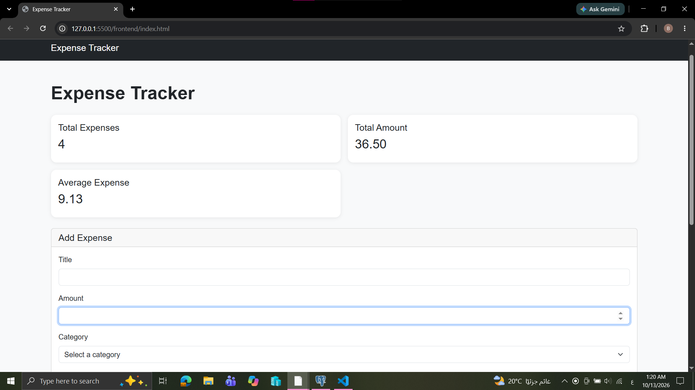
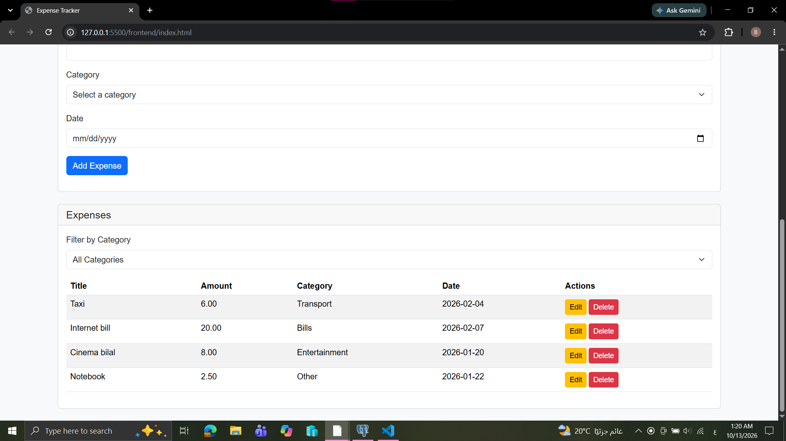
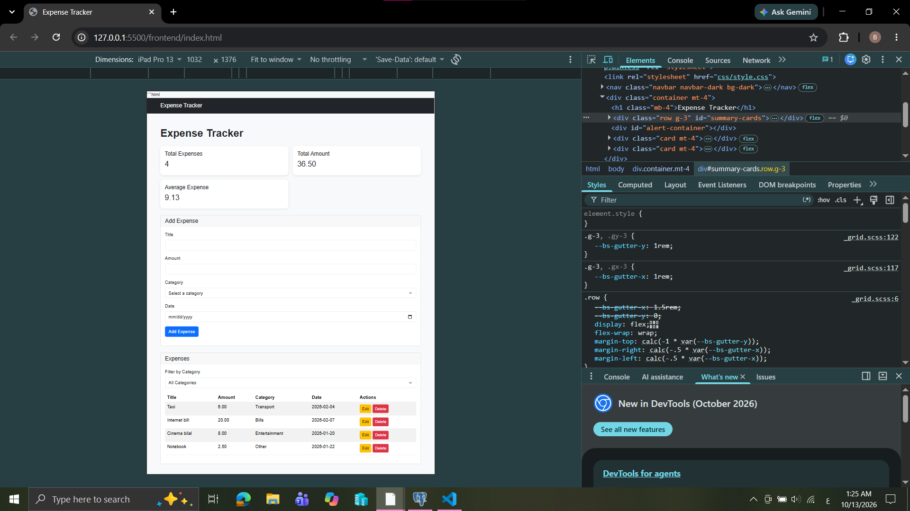

# Expense Tracker

This is a simple app to manage expenses. Users can add, edit, delete, and filter expenses. The app also shows some information about the expenses and saves the data in a PostgreSQL database.
## How to run

## How to run

---Backend

1. Open the project in VS Code.
2. Open the terminal and go to the backend folder.
3. Install the packages using `npm install`.
4. Create a database called `expense_tracker`.
5. Run the `schema.sql` file.
6. Create a `.env` file and add the database information.
7. Run the server using `node server.js`.

--Frontend

1. Open the frontend folder.
2. Open the `index.html` file in the browser.

## Features

<!-- List what your app can do. Tick what you finished. -->

- [ done ] Add an expense (with validation)
- [done ] Delete an expense
- [done ] Edit an expense
- [ done] Filter by category
- [ done] Summary cards (total, count, highest)
- [ done] Data is saved in a PostgreSQL database

## Screenshots

<!-- Add 2-3 screenshots of your app (desktop and mobile). -->## Screenshots

## What was the hardest part?

<!-- A short paragraph: what got you stuck, and how did you solve it? -->
## What was the hardest part?

The hardest part was connecting the frontend with the backend and the database. I fixed the problems by checking the code and trying again.